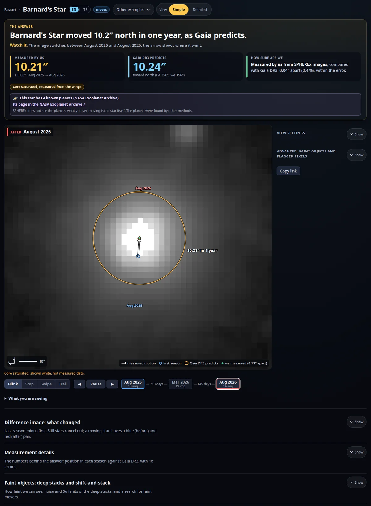
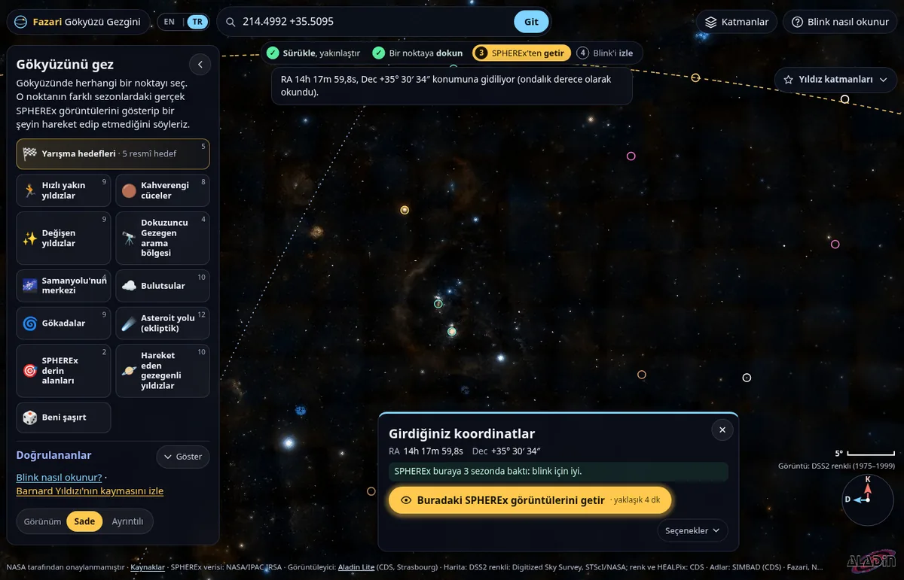
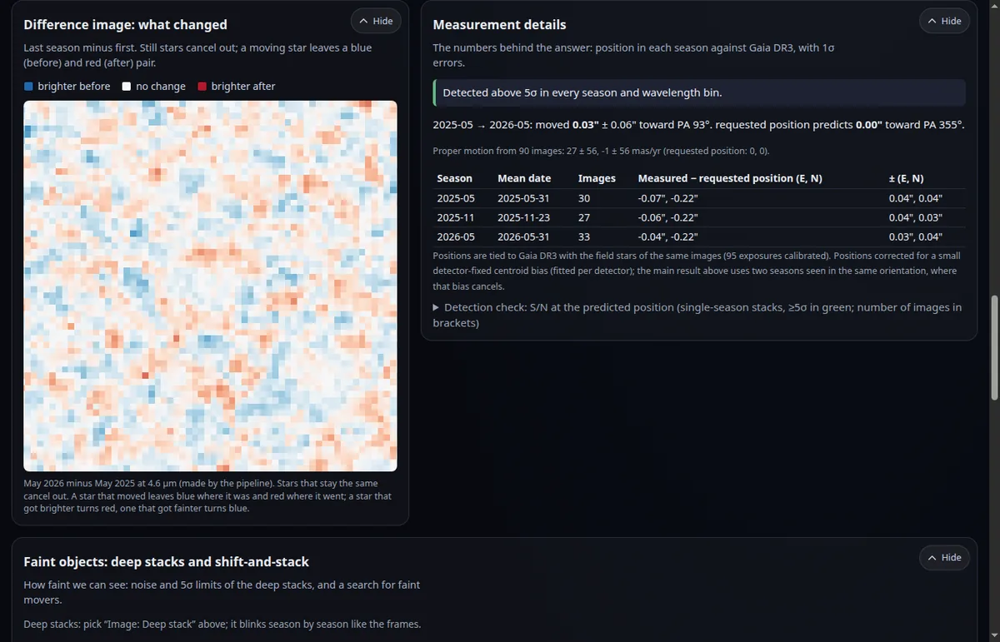
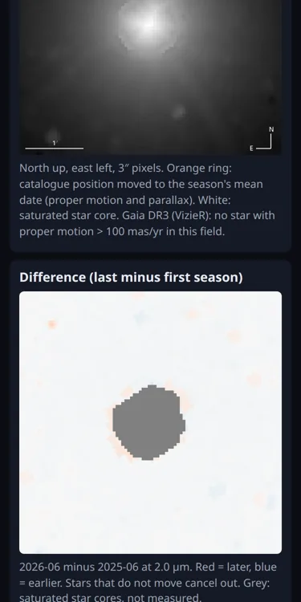

# Fazari — SPHEREx Blink Explorer

**Build began on 14 Nov 2026, after kick-off (first commit 07:00:59 UTC).** See the commit history.

| AI tool | Used for | Not used for |
|---|---|---|
| Claude Code (Anthropic; Claude Opus 5.5 and Claude Fable 5.2 models) | Writing code, tests and documentation; code review; research notes | Sky images and measurements: these are computed from NASA SPHEREx data by the code |
| Google Gemini | The team logo image (not in this repository; every copy shown carries a visible "AI-generated" watermark) | Anything in this repository or on the site |

Details: [Use of AI](#use-of-ai).



*The result viewer for Barnard's Star (`site/ornek.html`, English, simple view): the measured shift against the
Gaia DR3 prediction, the blink frame with the motion arrow, and the NASA Exoplanet Archive note for its known
planets.*



*The sky explorer (`site/explore.html`, Turkish interface): a typed coordinate, the object categories on the left and
the card that fetches the SPHEREx images of that point.*



*Viewer, detailed view: the difference image (last season minus first) and the measurement details per season
against Gaia DR3, with 1σ errors.*



*`site/sky.html` on a phone (English): season frame and difference image for a clicked point.*

Fazari shows images of the same patch of sky, taken by NASA's SPHEREx infrared observatory in different observing seasons, as a "blink" animation. Switching between the seasons makes moving objects (nearby brown dwarfs, high proper-motion stars) and changing sources easy to spot by eye. For each season the viewer marks where the target should be according to its Gaia DR3 position, proper motion and parallax, so real motion can be told apart from noise.

Challenge: [Planet X and SPHEREx](https://www.spaceappschallenge.org/2026/challenges/planet-x-and-spherex/) — NASA Space Apps Challenge 2026.

## Status

State on 14 November 2026, evening (branch `dev`, last commit 257a7c3). The hackathon runs 14–15 November 2026.

Live site: https://adembtr.github.io/fazari/ (published from `main`; the newest `dev` work appears there after the next release).

- **Five challenge targets:** done. Motion is measured and compared with the reference astrometry for Barnard's Star,
  Epsilon Indi B and WISE 0855-0714; relative brightness for RW Aurigae and R Draconis (viewer `site/ornek.html`).
- **Sky explorer (`site/explore.html`):** done. Search or click any point; the in-browser engine builds a blink there
  on the static site, the local Python engine does more when it runs on the same computer (see
  [What runs where](#what-runs-where)). Field-of-view selector, FLAGS layer, English/Turkish on every page.
- **Candidate finder v1 and known-asteroid recovery:** done, with a test round. Of 11 numbered verification tests
  7 pass, 3 fail (V4, V6, V11) and 1 reaches a limit (V8); see the summary at the top of
  [`pipeline/ACCURACY.md`](pipeline/ACCURACY.md).
- **Open:** in the injection test the best bin recovers 97.8 % of the fake movers, below the 99 % target (V6); in the
  blind run the direction of WISE 0855-0714 is 3.8σ off (V4). Every result is a
  candidate until checked.

## Challenge request → In Fazari

One row per required and suggested item of the challenge. Pages are in `site/`; the live site serves them at the
same names.

| # | Challenge request | In Fazari (page or file) | Status |
|---|---|---|---|
| 1 | Required: a public web tool | Live site https://adembtr.github.io/fazari/ (static, GitHub Pages); repository public, MIT | Done |
| 2 | Required: the user can enter any coordinate | `explore.html` search box (decimal or sexagesimal coordinates, decimal comma accepted, object names through CDS Sesame) or a click on the sky; `sky.html?ra=…&dec=…` | Done |
| 3 | Required: play the image series like a short video (blink) | `ornek.html` (Blink, Step, Swipe, Trail; play/pause, speed, season choice); `sky.html` for any point | Done |
| 4 | Required: moving objects easy to spot | Measured-motion arrow, season rings, Gaia DR3 marker, difference image, one-sentence answer card (`ornek.html`); preliminary "is it moving?" answer from the local engine (`local/quick.py`) | Done |
| 5 | Required: the five test targets | `ornek.html?data=data/<target>/` for Barnard's Star, Epsilon Indi B, WISE 0855-0714, RW Aurigae, R Draconis; numbers in [Result](#result) | Done |
| 6 | Suggested: easy to update as new data arrive | `pipeline/sky_index.py` rebuilds the static index of all SPHEREx DR1 and QR3 images (`site/index/`) with one command; both engines find images through it (the local engine falls back to IRSA SIA) | Partial: no scheduled automatic rebuild |
| 7 | Suggested: handle the 102 wavelengths sensibly | Six wavelength bins, each tied to one detector, so a blink never mixes detectors ([Method](#method) step 3; `site/js/sky.js` `CONFIG.bins`) | Done |
| 8 | Suggested: spectrum on the fly | Forced PSF photometry in every exposure at its own wavelength: `pipeline/spectrum.py`, `site/js/spectrum.js` (browser), chart in the viewer; `spectrum.json` for all five targets | Partial: at the target position, not at any clicked pixel |
| 9 | Suggested: add or subtract dates | Per-season stacks, difference image (last − first season), Trail, Swipe (`ornek.html`) | Done |
| 10 | Suggested: user-selected field of view | Field-of-view selector (`site/js/fov.js`, `site/explore/fov_ui.js`): 0.15–0.6° in the browser engine (phones up to 0.3°), 0.2–0.6° in the local engine | Done |
| 11 | Suggested: Gaia / WISE overlays | Gaia DR3 predicted position per season (WISE 0855-0714: Kirkpatrick et al. 2021); explorer layers with Gaia stars and fast stars; WISE, 2MASS and SPHEREx sky maps | Done |
| 12 | Suggested: coordinates in the URL (embeddable) | `explore.html?ra=&dec=&fov=`, `ornek.html?data=&um=&mode=&s=&z=`; the viewer runs inside the explorer as an iframe | Done |
| 13 | Suggested: metadata and flags (e.g. bad pixels) | FLAGS layer in the viewer (saturated / masked / other, per frame) and the per-frame image list (`site/js/flags_view.js`); dates, detector and wavelength range on every frame | Done |
| 14 | Suggested: use existing tools (Astropy, Aladin) | Pipeline on astropy and reproject; explorer on Aladin Lite v3 | Done |

Beyond the list:

| Addition | Where | Status |
|---|---|---|
| Known-asteroid recovery: 24 ecliptic fields, matched with SkyBoT from the SPHEREx position | `site/asteroids.html`, `site/data/asteroids/summary.json`, [`pipeline/ASTEROIDS.md`](pipeline/ASTEROIDS.md) | Done (test V8: limit) |
| Candidate finder for moving and changing sources in the whole field | `pipeline/detect/`, [`pipeline/DETECTION.md`](pipeline/DETECTION.md); local engine post-step | v1 done; tests V1–V11 |
| Quick decision: a preliminary "is it moving?" answer before the full result | `local/quick.py` (local engine) | Done |
| NASA Exoplanet Archive link for stars with known planets | Explorer and viewer cards; `site/data/exoplanet_hosts.json` | Done |
| English / Turkish on every page | `site/i18n/en.json`, `site/i18n/tr.json`, `site/js/i18n.js` | Done |
| Comets in SPHEREx: three comets (3I/ATLAS, C/2025 R2 (SWAN), C/2025 A6 (Lemmon)) and Pluto as a labelled bonus, selected over all public SPHEREx images with JPL SBDB and Horizons, then measured in the SPHEREx pixels (position, motion, coma, brightness per wavelength); known objects, not discoveries | `site/comets.html`, `site/data/comets/`, [`pipeline/COMETS.md`](pipeline/COMETS.md) | Done |
| Fast-star sweep: proper motions of Gaia DR3 fast stars measured in SPHEREx with one pre-registered procedure and compared with Gaia DR3 | [`pipeline/FAST_SWEEP.md`](pipeline/FAST_SWEEP.md), `site/data/fast_sweep/summary.json` | Done: 86 of 90 pre-registered stars measured, 4 failed (kept in the table); median difference to Gaia 7 % (5 % for the fastest 48; 0.17″/yr); 60.5 / 83.7 / 94.2 % within 1 / 2 / 3σ (ideal 68.3 / 95.4 / 99.7); smallest motion seen at 5σ 0.64″/yr; see [Fast-star sweep](#fast-star-sweep-90-pre-registered-stars) |
| Numbered verification data (V1–V11) | [`site/data/verify/tests.json`](site/data/verify/tests.json), evidence in `site/data/verify/evidence/`; summary in [`pipeline/ACCURACY.md`](pipeline/ACCURACY.md) | Done (7 pass, 3 fail, 1 limit) |

## What runs where

**Browser engine (the published static site; no server code).** The explorer opens `sky.html` in a panel for the
clicked point. `site/js/app.js` is the page: it resolves the input, looks the point up in the static sky index
(`site/index/`) and draws. The heavy work runs in a Web Worker (`site/js/worker.js`) that drives `SkySession` from
`site/js/sky.js`:

- reads only the needed image regions from IRSA's public S3 bucket with HTTP Range requests and decodes them;
- per exposure: IMAGE − ZODI, bad FLAGS pixels masked, reprojection onto one north-up grid; per season the median;
- a quick preview first (one wavelength, a few exposures per season, no calibration), then the full result
  (all wavelength bins, relative astrometry against Gaia DR3 field stars, `site/js/calib.js`);
- centroid of the target, season positions and the shift compared with the Gaia DR3 prediction; spectrum of the
  target (`site/js/spectrum.js`).

The five challenge targets are shown from precomputed pipeline results (`site/data/<target>/`). The browser
engine does not run the candidate finder, the quick decision or the finds list.

**Local Python engine (`local/serve.py`, on the team's computer, bound to 127.0.0.1).** It serves `site/` and a
small job API. The explorer uses it only when the page is opened from that computer and `/api/health` answers;
otherwise it uses the browser engine. It adds:

- full jobs (`local/job_worker.py` → `pipeline/blink.py`): all exposures within ±5.5 % of each bin centre, up to 30
  per season and bin by default (1–30; the first answer uses 3), all six bins, the detection check, the Gaia DR3 field
  calibration and the measurement, field 0.2–0.6° (default 0.2°: about 190 MB and 2 min); results are cached;
- a preview lane (`local/preview.py`) and the quick decision (`local/quick.py`: a 0.05° box from every exposure,
  a preliminary "is it moving?" answer);
- post-steps after a full job: spectrum, FLAGS layer, candidate finder (`pipeline/detect/`), faint-object mode,
  and the finds list (`pipeline/finds.py`, served at `/api/finds`, shown in the explorer on that computer only).

## Repository layout

- `pipeline/targets.json` — target catalog (position, proper motion, reference epoch, source).
- `pipeline/targets_extra.json` — parallaxes used for the Gaia prediction.
- `pipeline/download.py` — lists and downloads SPHEREx image cutouts from IRSA (Python standard library only).
- `pipeline/blink.py` — builds the blink frames and runs the detection check, measures the motion (motion targets) or the relative brightness (brightness targets).
- `pipeline/spectrum.py` — on-the-fly spectrum: forced PSF photometry of the target in every exposure, each at its own wavelength (`spectrum.csv`, `spectrum.json`). The browser engine does the same in `site/js/spectrum.js`; the chart is `site/js/spectrum_chart.js`.
- `pipeline/ASTROMETRY.md` — the Gaia DR3 field-star calibration, step by step.
- `pipeline/sky_index.py` — builds the static index of all SPHEREx DR1 and QR3 images (`site/index/`, format in `site/index/FORMAT.md`).
- `site/js/skyindex.js` — browser lookup in that index: which images cover a given RA/Dec.
- `local/` — local engine: serves the site and runs on-demand blink jobs for any clicked position (see `local/README.md`).
- `site/ornek.html` — viewer page (blink, wavelength choice, zoom, Gaia marker, difference image, measured motion).
- `site/explore.html` (+ `site/explore/`) — sky explorer; `site/sky.html` — blink for any point (browser engine, `site/js/`).
- `site/asteroids.html` — known-asteroid recovery results; `site/verify.html` — evidence page.
- `site/vr.html` — look around the sky (not yet linked from the site); its sky picture `site/data/vr/` (`sky_2k.jpg`, `sky_4k.jpg`, `sky.json`) is made by `pipeline/vr_sky.py` from the SPHEREx DR1 all-sky HiPS at IRSA.
- `site/comets.html` (+ `site/comets.js`) — comets in SPHEREx (three comets and Pluto), data in `site/data/comets/`; method and results in `pipeline/COMETS.md`.
- `pipeline/FAST_SWEEP.md` — fast-star sweep (SPHEREx vs Gaia DR3 proper motions, pre-registered rule); output in `site/data/fast_sweep/` (final, 86 of 90 stars measured).
- `pipeline/detect/` — candidate finder (see `pipeline/DETECTION.md`); `pipeline/finds.py` — finds list of the local engine.
- `site/data/verify/tests.json` — numbered verification tests V1–V11, evidence in `site/data/verify/evidence/`.
- `docs/img/` — screenshots used in this README.
- `site/data/<target>/` — pipeline output: `frames/*.png`, `blink_*um.gif`, `diff_*um.png`, `images.csv` (per-exposure diagnostics), `meta.json` (read by the viewer). `gaia_field.json` — cached Gaia DR3 field stars (motion targets).

## Reproduce

Requires Python 3 and [uv](https://docs.astral.sh/uv/).

1. Download the cutouts (resumable; files already on disk are skipped):

   ```
   python3 -I pipeline/download.py list barnard
   python3 -I pipeline/download.py download barnard            # DR1 and QR3
   python3 -I pipeline/download.py download barnard --collection dr1
   ```

   Data directory: `--data-dir DIR`, else the `FAZARI_DATA` environment variable, else `../veri/real_spherex` next to the repository if it exists, else `raw/` inside the repository (not committed). Layout: `<data>/<target>/liste_<collection>.csv` and `<data>/<target>/<collection>/*.fits`.

2. Build the frames and the measurement (writes to `site/data/<target>/`, or to `$FAZARI_OUT/<target>/` if set):

   ```
   uv run --no-project --with astropy --with reproject --with numpy --with scipy \
       --with matplotlib --with pillow python -I pipeline/blink.py barnard
   ```

3. View locally:

   ```
   cd site && python3 -m http.server 8765
   ```

   then open http://127.0.0.1:8765/ornek.html

4. Refresh the sky index (from the `fazari/` folder):

   ```
   uv run --no-project --with numpy --with healpy python -I pipeline/sky_index.py build
   ```

   (resumable; runs `fetch` first if the cache is incomplete), then republish `site/index/`.

## Method

1. **Data.** We find the SPHEREx Level 2 spectral images that contain the target with the
   IRSA SIA service and download a 0.2° cutout of each.
2. **Seasons.** Exposures are grouped into observing seasons wherever consecutive dates are
   more than 30 days apart.
3. **Wavelength bins.** We read the wavelength at the target pixel from each image's spectral
   WCS. Exposures go into bins at 1.0, 1.5, 2.0, 3.0, 4.0 and 4.6 µm (±6 %).
   - Each bin is tied to one detector: D1, D2, D3, D4, D5, D6. So 4.0 µm means D5 at
     3.83–4.24 µm, and 4.6 µm means D6 at 4.42–4.88 µm.
   - A frame never mixes detectors, and only matching wavelengths are blinked.
4. **Cleaning.** In each exposure we subtract the ZODI (zodiacal light) model, mask the bad
   pixels from the FLAGS layer and mark saturated pixels.
5. **Blink frames.** Exposures are reprojected onto one north-up TAN grid centred on the
   target (3″/pixel, 0.15° field) and median-stacked per season and bin. All frames of a bin
   share one asinh stretch.
6. **Predicted position.** We move the catalogue position to each exposure's time with:
   - proper motion;
   - perspective acceleration, when a radial velocity is known (Barnard's Star);
   - annual parallax, from the Earth's barycentric position.
7. **Detection check.** This runs before any astrometric fit.
   - We fit the SPHEREx empirical PSF (the EPSF extension of each file) at the predicted
     position, with the flux free.
   - Catalogue neighbours and Gaia DR3 field stars are fitted at the same time at fixed
     positions, plus a constant background.
   - Fluxes are combined per season and detector. Errors are calibrated with the same fit at
     random positions in the same exposures.
   - A season × detector stack counts as a detection at S/N ≥ 5 (or a saturated core).
   - The astrometric fit uses only the detected stacks. A target detected nowhere gets
     `status: not_detected` and no motion numbers.
8. **Astrometric calibration against Gaia DR3.**
   - In every exposure we measure unsaturated, isolated Gaia DR3 field stars (G 10–17.5,
     RUWE ≤ 1.4), moved to the exposure time.
   - Their measured − Gaia offsets are pooled per season and detector. We fit a shift, plus
     rotation and scale when enough stars surround the target, with 3σ clipping.
   - That offset is removed from the target. Weak cells use the median of the same season.
   - The field-star lists are cached in `site/data/<target>/gaia_field.json`. The exact
     algorithm is in [`pipeline/ASTROMETRY.md`](pipeline/ASTROMETRY.md).
9. **Astrometry, bright targets** (saturated core, or S/N ≥ 20 per exposure):
   - A pixel-integrated Gaussian is fitted to the unsaturated pixels in native pixels.
   - Gaia DR3 stars with G < 17 and more than 15″ away are fitted at the same time at their
     fixed positions. Their light would otherwise pull the wing fit: for Barnard's Star, a
     G = 15 star 35″ to the NE moved the position by about 0.2″.
   - A joint fit of all exposures solves for position and proper motion. The parallax is
     fixed to the catalogue value, and there is one centroid offset per detector, fixed in
     detector axes.
10. **Astrometry, faint targets.**
    - For each season, one common position is fitted to all detected exposures. It is the
      EPSF position that minimises the summed χ² on a grid around the prediction, with the
      neighbours modelled.
    - Errors are the larger of the χ² curvature and a bootstrap over the exposures.
    - A weighted linear fit of the season positions then gives the proper motion.
11. **Relative photometry, brightness targets.**
    - In each exposure of a bin, the target flux is divided by the mean of 2–5 comparison
      stars. The comparison stars are bright, isolated and unsaturated, found in the stacks.
    - A saturated target core is measured in an annulus just outside the largest saturated
      core of the bin. The annulus is the same for all seasons; it is a wing-based estimate
      and is flagged.
    - The season value is the median. It is reported as a ratio to the first season.
    - The error combines the robust scatter of both seasons and the apparent
      season-to-season change of the comparison stars themselves.

## Result

### Summary: speed, catalogue value and shift

| Target | Measured speed (″/yr) | Measured direction (PA) | Catalogue speed (″/yr) and direction | Catalogue source | Test | Measured shift (same orientation) | Time span |
|---|---|---|---|---|---|---|---|
| Barnard's Star | 10.361 ± 0.051 | 355.4° ± 0.3° | 10.393 at 355.6° | Gaia DR3 | V1 pass | 10.207″ ± 0.06″ (2025-08 → 2026-08) | 0.982 yr |
| Epsilon Indi B | 4.678 ± 0.02 | 121.6° ± 0.2° | 4.684 at 121.8° | Gaia DR3 | V2 pass | 4.535″ ± 0.029″ (2025-10 → 2026-09) | 0.9647 yr |
| WISE 0855-0714 | 8.429 ± 0.377 | 284.2° ± 2.5° | 8.152 at 274.7° | Kirkpatrick et al. 2021, ApJS 253, 7 (total proper motion) | V4 **fail** (direction 3.8σ off) | 8.419″ ± 0.558″ (2025-05 → 2026-05) | 0.9855 yr |
| Luhman 16AB | 2.678 ± 0.059 | 274.3° ± 1.5° | 2.79 at 277.4° | SIMBAD via CDS Sesame, retrieved 2026-11-14 (no Gaia DR3 proper motion) | V3 pass | 2.75″ ± 0.058″ (2025-06 → 2026-06) | 0.9945 yr |

Sources:

- Speed, direction, catalogue speed and test status: [`site/data/verify/tests.json`](site/data/verify/tests.json)
  V1–V4. The candidate finder measured them blind, without being told where the target is.
- Catalogue source: `gaia.label` in `site/data/<target>/meta.json`; for Luhman 16AB, the speed reference 2.79″/yr comes from
  `gaia.reference` in the local-engine job's `meta.json` (`cache/jobs/luhman16-162.295s53.317-c6-b63-pm8778/`):
  "SIMBAD via CDS Sesame (NAME Luhman 16, type **), retrieved 2026-11-14" (μα* −2767.502, μδ +356.856 mas/yr,
  epoch 2000, parallax 0); `pipeline/accuracy.py` copies it to `reference` in [`site/data/accuracy.json`](site/data/accuracy.json).
- Shift and time span: the headline pair in `site/data/<target>/meta.json` (`measured.shift_arcsec`,
  `shift_err_arcsec`, `dt_years`); for Luhman 16AB, `shift` in `site/data/accuracy.json` (a local-engine job
  of 104 cutouts; Luhman 16AB has no `site/data/` folder).
- The catalogue speed is a total proper motion. It is not the shift expected over the observed interval, which
  also depends on the interval and on parallax; the per-target tables below compare the shift with that
  prediction.

### Per target

From `site/data/<target>/meta.json`. The headline shift uses two seasons seen with the same
telescope orientation, where detector-fixed centroid offsets cancel.

#### Barnard's Star

358 cutouts; seasons 2025-08, 2026-03, 2026-08. Detected in every season and bin (saturated
core).

| | Measured | Gaia DR3 prediction |
|---|---|---|
| Shift 2025-08 → 2026-08 (0.98 yr) | 10.21″ ± 0.06″ at PA 355.7° | 10.24″ at PA 355.7° |
| Proper motion (joint fit, 335 exposures) | −810 ± 56, 10336 ± 56 mas/yr | −802, 10362 mas/yr |
| Position − Gaia, per season (E, N) | (−0.05″, +0.15″), (−0.05″, +0.13″), (−0.05″, +0.11″) ± 0.04″ | 0 |

#### Epsilon Indi B

458 cutouts; seasons 2025-04, 2025-10, 2026-04, 2026-09. Detected in every season and bin.

| | Measured | Gaia DR3 prediction |
|---|---|---|
| Shift 2025-10 → 2026-09 (0.96 yr) | 4.54″ ± 0.03″ at PA 122.0° | 4.56″ at PA 121.8° |
| Proper motion (joint fit, 439 exposures) | 3945 ± 25, −2419 ± 25 mas/yr | 3982, −2467 mas/yr |

**Finding.** SPHEREx's infrared position of Epsilon Indi B is offset from the Gaia DR3
prediction by about +0.27″ E, −0.53″ N (±0.03″ per season).

- The offset is the same in both spacecraft orientations, so it is on the sky, not
  instrumental.
- It is the same before and after the field-star calibration.
- It is larger at 4–5 µm (about 0.7″) than at 1–3 µm (about 0.5″).
- No Gaia DR3 star lies within 45″ that could contaminate the fit.
- Scattered light from Eps Indi A (6.7′ W) does not explain it: subtracting a fitted local
  background plane changes the offset by < 0.02″, and Gaia field stars at the same distance
  from A are offset by < 0.04″ (check: `pipeline/eps_indi_check.py`).

This is consistent with the binary nature of the source. Ba+Bb are not resolved in the Gaia
DR3 solution, which has RUWE 4.30 and astrometric excess noise 5.8 mas. The infrared
photocentre, where the cooler Bb contributes more, can differ from Gaia's G-band photocentre.
Orbital motion since the Gaia epoch (2016) adds to this.

#### WISE 0855-0714

258 cutouts; seasons 2025-05, 2025-11, 2026-05. The object is not in Gaia. Reference
astrometry is Kirkpatrick et al. 2021 (ApJS 253, 7), from Spitzer:

- position at MJD 57633.39;
- μ = −8123.7, +673.2 mas/yr;
- parallax 439.0 mas.

It is **detected only at 4.0 and 4.6 µm** (D5, D6):

- single-season S/N 10–16 per detector;
- about 270–530 µJy within the PSF core;
- not detected (S/N < 5) at 1.0–3.0 µm.

A W2 = 15.2 background star (CatWISE J085501.95-071428.2) lies 11″, 8″ and 4″ from the
predicted position in the three seasons. It is fitted together with the target.

| | Measured (D5+D6) | Predicted from Kirkpatrick et al. 2021 (same interval, with parallax) |
|---|---|---|
| Shift 2025-05 → 2026-05 (0.99 yr) | 8.4″ ± 0.6″ at PA 277° | 8.03″ at PA 274.6° |
| Proper motion (3 season positions) | −8370 ± 600, +1100 ± 630 mas/yr | −8124, +673 mas/yr |

Earlier versions fitted all wavelengths. At short wavelengths only the background star is
visible, so the fit locked onto it and gave no motion. The detection check now prevents
this.

As a control, a static W2 = 15.5 field star in the same images was put through the same
faint-target fit. It gave 34 ± 160, 159 ± 155 mas/yr.

#### RW Aurigae and R Draconis (relative photometry)

Both are saturated in every band, so the values are wing (annulus) estimates. Ratios are to
the first season.

| Target | Bin | Season 2 | Season 3 |
|---|---|---|---|
| RW Aur (2025-09 → 2026-03, 2026-09) | 1.0 µm | 1.13 ± 0.13 | 1.37 ± 0.13 |
| | 2.0 µm | 1.09 ± 0.09 | 1.05 ± 0.05 |
| | 4.0 µm | 0.82 ± 0.04 | 0.50 ± 0.04 |
| | 4.6 µm | 0.69 ± 0.04 | 0.49 ± 0.04 |
| R Dra (2025-06 → 2025-11, 2026-06) | 1.0 µm | 0.65 ± 0.10 | 0.58 ± 0.08 |
| | 2.0 µm | 0.94 ± 0.19 | 0.54 ± 0.12 |
| | 4.6 µm | 0.79 ± 0.05 | 0.52 ± 0.03 |

- RW Aur fades by about a factor of 2 at 4–5 µm over the year, while it is constant or
  brighter at 1–2 µm. RW Aur A is known for deep dimming events, so a change of this size is
  plausible.
- R Dra is a Mira variable (P ≈ 245 d), so changes of a factor of 2 are expected.
- These are differential wing measurements of saturated stars. Treat them as indicative, not
  as calibrated light curves. Full tables with errors and flags are in the viewer.

## Fast-star sweep (90 pre-registered stars)

Before measuring anything we wrote down a list of 90 fast-moving stars: the 50 fastest that SPHEREx saw twice from
the same angle, plus 40 picked at random across five speed ranges. We then measured every one of them in real
SPHEREx images with a single fixed method, using ESA's Gaia catalogue only to line up the other stars in each image,
never the star being measured. 86 of the 90 gave a motion; the 4 that did not are kept in the table with the reason.
The typical star agrees with Gaia to 7 % (5 % for the fastest 48), which is about 0.17 arcseconds per year. When we
deliberately started the fit from a motion that was 10 % wrong, the answer typically moved by well under 1 % of that
error, so the result comes from the images, not from Gaia. Our error bars are right for the typical star, but a few
stars miss by more than their error bars say: 94 % agree within 3 sigma, where 99.7 % would be ideal. We publish
those misses, and their likely causes in our code, instead of hiding them. The full table, the figure and every
number are in site/data/fast_sweep/ and pipeline/FAST_SWEEP.md.

Known issues, stated rather than fixed tonight: 8 stars have fits with no degrees of freedom left (dof = 0; HD 132142 is the worst), and LAWD 37 and Ross 578 come out about 22 % slow. The 5 stars outside 3σ are HD 132142, LAWD 37, Ross 578, BD+02 348 and G 254-24.

## Known limitations

- The pipeline uses 0.2° cutouts around each target, not full SPHEREx images.
- Barnard's Star is saturated in its core; its position comes from the unsaturated wings,
  with one centroid offset per detector fitted in detector axes. Every season is still about
  +0.13″ N (±0.04″) from the Gaia DR3 prediction, and agrees in E. It cancels in the shifts
  and proper motions.
- WISE 0855-0714 is faint for SPHEREx. Its season positions have 0.2–0.45″ errors. The
  field-star calibration is not applied to it: D5/D6 have too few Gaia stars (5 per cell,
  ±0.1″), well below its own errors.
- Relative photometry of saturated stars uses the PSF wings in an annulus. Static stars inside
  the annulus dilute the measured change. A ±6 % bin can sample molecular bands differently
  in different seasons. R Dra has no photometry at 4.0 µm (too few usable comparison stars).
- The detection threshold (5σ per season and detector) and the noise calibration are
  empirical.

## Data and credits

- [SPHEREx DR1 spectral images](https://doi.org/10.26131/IRSA678) — NASA/IPAC Infrared Science Archive (IRSA), DOI: 10.26131/IRSA678
- [SPHEREx QR3 spectral images](https://doi.org/10.26131/IRSA662) — NASA/IPAC IRSA, DOI: 10.26131/IRSA662
- Sky picture of `site/vr.html` (made by `pipeline/vr_sky.py`, `site/data/vr/`): SPHEREx DR1 all-sky HiPS: NASA/SPHEREx, Caltech/IPAC (NASA/IPAC Infrared Science Archive). False colour from 9 of the 102 wavelength frames: blue 1.05-1.14 um, green 2.0-2.19 um, red 3.29-3.67 um. Source: https://irsa.ipac.caltech.edu/data/hips/SPHEREx/spherex_allsky_cube
- [Gaia DR3](https://www.cosmos.esa.int/web/gaia/dr3) — European Space Agency (ESA), a Space Apps partner agency. Positions, proper motions and parallaxes of the targets are Gaia DR3 values (except WISE 0855-0714).

This publication makes use of data products from the Spectro-Photometer for the History of the Universe, Epoch of Reionization and Ices Explorer (SPHEREx), which is a joint project of the Jet Propulsion Laboratory and the California Institute of Technology, and is funded by the National Aeronautics and Space Administration.

This work has made use of data from the European Space Agency (ESA) mission Gaia (https://www.cosmos.esa.int/gaia), processed by the Gaia Data Processing and Analysis Consortium (DPAC).

This is a hackathon project by Team Fazari. It is not endorsed by NASA or ESA.

## References

Everything below is used by the site or the pipeline (checked in the code, November 2026). The site's
Credits panel (explore.html) carries the same list.

Data and services

- SPHEREx DR1 and QR3 spectral images: NASA/JPL-Caltech, SPHEREx team; NASA/IPAC Infrared Science
  Archive (IRSA), [doi:10.26131/IRSA678](https://doi.org/10.26131/IRSA678) and
  [doi:10.26131/IRSA662](https://doi.org/10.26131/IRSA662). The SPHEREx all-sky map layer is the IRSA
  SPHEREx DR1 HiPS.
- SPHEREx mission: Crill, B. P. et al., "SPHEREx: NASA's Near-Infrared Spectrophotometric All-Sky Survey",
  [arXiv:2404.11017](https://arxiv.org/abs/2404.11017).
- [Registry of Open Data on AWS](https://registry.opendata.aws/spherex-qr/): the browser and local
  engines read SPHEREx images from IRSA's public S3 bucket `nasa-irsa-spherex` (accessed November 2026).
  Some DSS2 and Pan-STARRS map tiles come from STScI/MAST's public bucket `stpubdata`, one of several mirrors.
- Gaia DR3 (ESA, partner agency): Gaia Collaboration, Prusti et al. 2016, A&A 595, A1; Gaia Collaboration,
  Vallenari et al. 2023, A&A 674, A1. Via CDS VizieR (I/355/gaiadr3) and the ESA Gaia archive.
- Tycho-2 (reference stars in sky.html): Høg et al. 2000, A&A 355, L27, via CDS VizieR.
- [DSS2 colour](https://archive.stsci.edu/dss/): Digitized Sky Survey, STScI/NASA; coloured and HEALPixed by CDS.
- [2MASS](https://irsa.ipac.caltech.edu/Missions/2mass.html): Skrutskie et al. 2006, AJ 131, 1163 (sky map;
  near-infrared magnitudes of fast stars through the Gaia DR3 cross-match).
- [AllWISE](https://irsa.ipac.caltech.edu/Missions/wise.html): Wright et al. 2010, AJ 140, 1868; Cutri et al. 2013,
  Explanatory Supplement to the AllWISE Data Release Products (sky map; W1 magnitudes of fast stars through
  the Gaia DR3 cross-match).
- [CatWISE2020](https://catwise.github.io/): Marocco et al. 2021, ApJS 253, 8, via IRSA (static reference
  stars around WISE 0855-0714).
- [Pan-STARRS1 DR1](https://outerspace.stsci.edu/display/PANSTARRS/): Chambers et al. 2016, arXiv:1612.05560;
  Flewelling et al. 2020, ApJS 251, 7. Images from STScI/MAST, HEALPixed by CDS (sharp close-up map).
- [SIMBAD](https://simbad.cds.unistra.fr/simbad/): Wenger et al. 2000, A&AS 143, 9; with the CDS Sesame name resolver.
- [VizieR](https://vizier.cds.unistra.fr/): Ochsenbein, Bauer & Marcout 2000, A&AS 143, 23;
  [doi:10.26093/cds/vizier](https://doi.org/10.26093/cds/vizier).
- [NASA Exoplanet Archive](https://exoplanetarchive.ipac.caltech.edu/): Planetary Systems Composite Parameters
  table ([doi:10.26133/NEA13](https://doi.org/10.26133/NEA13)); Christiansen et al. 2025, PSJ (the archive's paper).
  One TAP query on 2026-11-14 gave 6470 planets around 4862 host stars (`site/data/exoplanet_hosts.json`, built by
  `pipeline/exoplanet_hosts.py`); the explorer and the result viewer say when a star has known planets and link its
  archive page. SPHEREx sees these stars move; the planets were found by other methods.
- WISE 0855-0714 motion and parallax: Kirkpatrick et al. 2021, ApJS 253, 7.
- Planet Nine band: Brown & Batygin 2021, AJ 162, 219; Brown, Holman & Batygin 2024, arXiv:2401.17977.

Software

- [Aladin Lite v3](https://aladin.cds.unistra.fr/AladinLite/) (CDS, Strasbourg; GPL-3.0): Boch & Fernique 2014,
  ASPC 485, 277; Bonnarel et al. 2000, A&AS 143, 33. Loaded unmodified from its npm build.
- Python: astropy, reproject, NumPy, SciPy, Matplotlib, Pillow (see Tools).

Acknowledgements requested by the providers

This research has made use of the NASA/IPAC Infrared Science Archive, which is funded by the National
Aeronautics and Space Administration and operated by the California Institute of Technology.

This publication makes use of data products from the Two Micron All Sky Survey, which is a joint project of
the University of Massachusetts and the Infrared Processing and Analysis Center/California Institute of
Technology, funded by the National Aeronautics and Space Administration and the National Science Foundation.

This publication makes use of data products from the Wide-field Infrared Survey Explorer, which is a joint
project of the University of California, Los Angeles, and the Jet Propulsion Laboratory/California Institute
of Technology, funded by the National Aeronautics and Space Administration. This publication also makes use of
data products from NEOWISE, which is a project of the Jet Propulsion Laboratory/California Institute of
Technology, funded by the Planetary Science Division of the National Aeronautics and Space Administration.

The Pan-STARRS1 Surveys (PS1) and the PS1 public science archive have been made possible through
contributions by the Institute for Astronomy, the University of Hawaii, the Pan-STARRS Project Office, the
Max-Planck Society and its participating institutes, the Max Planck Institute for Astronomy, Heidelberg and the
Max Planck Institute for Extraterrestrial Physics, Garching, The Johns Hopkins University, Durham University,
the University of Edinburgh, the Queen's University Belfast, the Harvard-Smithsonian Center for Astrophysics,
the Las Cumbres Observatory Global Telescope Network Incorporated, the National Central University of Taiwan,
the Space Telescope Science Institute, the National Aeronautics and Space Administration under Grant No.
NNX08AR22G issued through the Planetary Science Division of the NASA Science Mission Directorate, the National
Science Foundation Grant No. AST-1238877, the University of Maryland, Eotvos Lorand University (ELTE), the Los
Alamos National Laboratory, and the Gordon and Betty Moore Foundation.

The Digitized Sky Surveys were produced at the Space Telescope Science Institute under U.S. Government grant
NAG W-2166. The images of these surveys are based on photographic data obtained using the Oschin Schmidt
Telescope on Palomar Mountain and the UK Schmidt Telescope. The plates were processed into the present
compressed digital form with the permission of these institutions.

This research has made use of the NASA Exoplanet Archive, which is operated by the California Institute of
Technology, under contract with the National Aeronautics and Space Administration under the Exoplanet
Exploration Program.

This research has made use of the SIMBAD database, the VizieR catalogue access tool, the Sesame name resolver
and the Aladin Lite sky atlas, operated at CDS, Strasbourg, France.

## Tools

Python (astropy, reproject, NumPy, SciPy, Matplotlib, Pillow), uv, HTML, CSS, JavaScript, NASA/IPAC IRSA SIA and cutout services.

## Use of AI

Code and documentation in this repository were written with help from Anthropic's Claude (Claude Code). Commits made with AI help carry a `Co-Authored-By: Claude` trailer. Team Fazari designed the project and checked and tested the results.

The same note is on the site (Credits panel and page footers), and every result file
(`site/data/*/meta.json`, `site/data/categories.json`, new local-engine jobs) carries an
`ai_disclosure` field. The sky images and measurements come from the data listed above, not from an AI model.

## License

MIT — see [LICENSE](LICENSE).

---

Team Fazari — Sakarya, Türkiye
